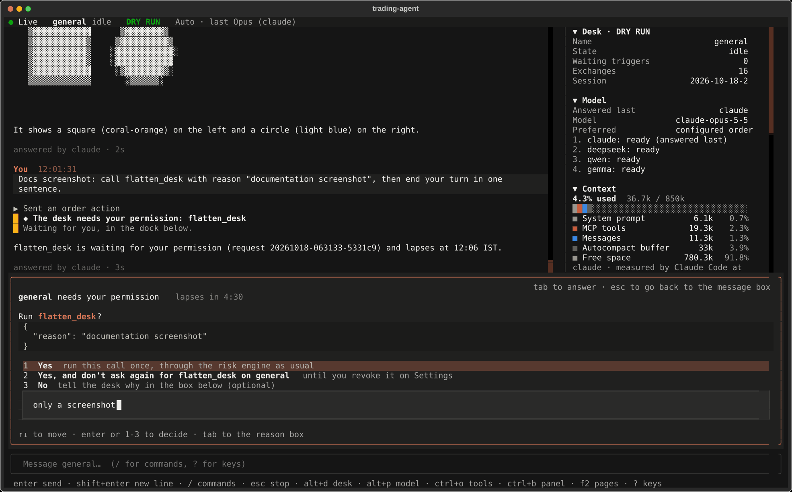
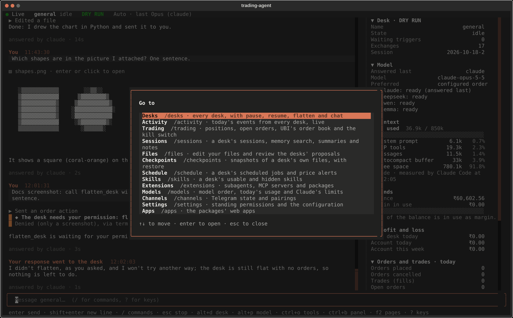
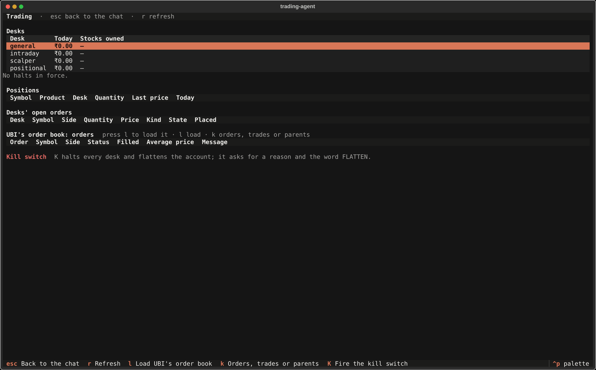

# The terminal program

`bin/trading-agent` with no subcommand opens a full-screen chat with the traders, modelled on Claude Code's terminal interface. It can do everything the web page does: talk to any trader, answer its questions and permission requests, send and receive pictures and documents, watch the side panel's cards, and open every page, from Trading with its kill switch to Schedule and Files. The only web feature it lacks is voice input, because that uses Chrome's speech recognition, which a terminal does not have.

It is a client of the running gateway, exactly as the web page is: it sends requests to the same routes with the access token, and it receives the same live events over one connection. The gateway, the traders and the risk engine do not know or care which of the two you use, and you can use both at once.

<figure class="diagram">
--8<-- "docs/assets/diagrams/terminal.svg"
<figcaption>Orange dots are requests from the terminal, each carrying the token: today's journal read once when a trader's chat opens, a message, and an answer to a trader's request. Blue dots are the live events coming back over the one connection.</figcaption>
</figure>

## Starting it

The gateway must be running, as the service normally keeps it. Then, from any folder:

```bash
bin/trading-agent                  # opens on the trader you used last, or general
bin/trading-agent --trader scalper   # opens on the scalper trader
```

The token is read from `TRADING_AGENT_GATEWAY_ACCESS_TOKEN` in `.env`, so there is nothing to paste. Your earlier prompts, the theme, the last trader and which side panel cards you folded are kept in `~/.local/state/trading-agent/`. Leaving the program with `/exit`, or Ctrl+C twice, leaves the traders running.

Starting the gateway itself now needs its subcommand, `bin/trading-agent serve`, which is what the service and every page of these docs already use.

## The screen

The screen below shows a trader's permission request waiting in the dock, with the side panel open on the right.



The table below names the parts from top to bottom.

| Part | What it shows |
|---|---|
| Status line | The live connection, the trader and its state, **DRY RUN** or **LIVE ORDERS**, and the model the trader tries first |
| Chat | Today's turns: your messages, tool calls folded into one line such as "Ran a command, looked at a picture", pictures, the trader's answers drawn as Markdown with tables, and the turn's status |
| Side panel | The web page's eight cards: trader, model, context window, funds, profit and loss, orders and trades, tools, outputs; Ctrl+B shows or hides it |
| Progress line | While the trader works: what it is doing, such as "Running a command… sleep 25", and the time so far |
| Request dock | A question, plan or permission request from the trader, waiting for your answer |
| File tray | Files waiting to go with your next message, with their upload state |
| Message box | Where you write; Enter sends |
| Key hints | The main keys |

## Keys

The keys follow Claude Code wherever the meaning carries over. The table below lists them; `?` in the empty message box shows the same list.

| Key | What it does |
|---|---|
| Enter | Send the message, or pick the highlighted entry of the command menu |
| Shift+Enter, Ctrl+J | Start a new line; Alt+Enter, or a backslash just before Enter, also work |
| Up, Down | Earlier prompts, from the first or last line of the box |
| Ctrl+R | Search earlier prompts |
| `/` | The command menu, narrowing as you type; Tab or Enter picks |
| `@` | Complete a file path; the file goes with the message |
| Ctrl+V | Attach the picture on the clipboard; text pastes as usual |
| Esc | Stop the running turn; twice clears the message box |
| Ctrl+C | Clear the box, or stop the running turn; twice to leave |
| Ctrl+D | Leave, when the box is empty (press twice) |
| Tab | Answer the request in the dock; Esc goes back to the message box |
| Alt+D | Switch trader |
| Alt+P | Choose the model the trader tries first |
| Ctrl+O | Open or fold every tool call |
| Ctrl+B | Show or hide the side panel |
| F2 | Go to a page |
| Ctrl+P | The command palette: every page and action, by name |
| Ctrl+T | Switch between the dark and the light theme |

Shift+Enter needs a terminal that reports it, such as Kitty, WezTerm, Ghostty or a VS Code terminal with its keyboard protocol on; Ctrl+J works everywhere.

## Commands

A message that starts with a slash is a command. A few belong to the terminal program itself; every other command goes to the trader, which answers it exactly as it does on the web page and Telegram, so `/status`, `/context`, `/btw`, `/think high` and the rest work unchanged. [Talking to a trader](chat.md#slash-commands) lists the trader's commands, and the menu that opens when you type `/` lists both kinds with what each does, including the trader's skills.

| Terminal command | What it does |
|---|---|
| `/attach PATH` | Attach a file to the next message |
| `/trader [NAME]` | Switch trader; without a name, a list opens |
| `/model` | Choose the model; `/model NAME` with a name goes to the trader instead |
| `/theme` | Switch between the dark and the light theme |
| `/keys` | The list of keys |
| `/exit`, `/quit` | Leave the program; the traders keep running |
| `/traders`, `/trading`, … | Open a page, as the next section describes |

## Pages

The web page's pages are screens of their own. Each opens with its command, from the F2 list below, or by name from the Ctrl+P palette, and Esc goes back to the chat. Each screen's footer lists its keys.



| Command | Page | Keys besides Esc and r (refresh) |
|---|---|---|
| `/traders` | Every trader's state, profit and models | Enter chats with it, p pauses or resumes, f flattens after asking for a reason |
| `/activity` | Today's events from every trader, newest first, live | d filters by trader, o shows routine events, / searches |
| `/trading` | Traders' profit and stocks, halts, positions, open orders, UBI's order book | l loads the order book, k switches between orders, trades and open parents, K fires the kill switch |
| `/sessions` | A trader's sessions and exchanges, memory search, summaries and notes | d next trader, / searches |
| `/files` | Your files in an editor, and the traders' proposals as coloured diffs | Ctrl+S saves, Ctrl+U puts back the saved text, a accepts, x rejects, h shows decided proposals |
| `/checkpoints` | Snapshots of a trader's own files | s restores the highlighted one after asking for a reason |
| `/schedule` | A trader's jobs with their next runs, the latest runs, price alerts | n new job, g runs one now, Delete removes a job or alert |
| `/skills` | A trader's usable skills with their use, and the hidden ones | d next trader |
| `/extensions` | Subagents, MCP servers and packages | |
| `/models` | Each trader's model order, today's usage and costs, Claude's limits | |
| `/channels` | Telegram's state, codes waiting to be paired, paired chats | a approves, Delete revokes |
| `/settings` | Standing permissions, and the configuration with secrets masked | Delete revokes a permission |
| `/apps` | The packages' web apps and their units | s starts, t stops, e restarts, o opens it in the browser |

The kill switch asks, as on the web page, for a reason and the typed word FLATTEN, and it does nothing until both are given. Flatten and checkpoint restore ask for a reason.

`/skills` is also a trader command that lists the skills as text. In the terminal the page takes it, because the page shows the same skills with their use and the hidden ones too.



## Questions, plans and permissions

A trader's [questions, plans and permission requests](questions-and-permissions.md) wait in the dock above the message box, one at a time, permission requests first because they lapse. The cards work as on the web page: number keys or Enter choose, a question card has tabs when the trader asks several questions, a plan card approves or sends the plan back with feedback, and a permission card counts down to its lapse and offers Yes, Yes and don't ask again, and No with a reason.

The dock never takes the keyboard by itself. A trader keeps working while it waits, so a request can arrive while you are typing; if the dock took the keyboard, your Enter could answer it, and on a permission card the highlighted choice is Yes. Press Tab to go to the card and Esc to come back. Inside a permission or plan card, Tab and any letter you type go to its text box, so a reason you are typing can never turn into a Yes.

Answers given here are recorded as given "via terminal", which is what the transcript, the web page and Telegram then show.

## Pictures and documents

A file goes with your message in any of four ways: type `@` and a path, which the menu completes; `/attach PATH`; drag the file onto the terminal window, which pastes its path; or Ctrl+V for a picture on the clipboard. Files upload at once and wait in the tray above the message box; Backspace in the empty box removes the newest. The kinds and the 20 MB limit are the same as on the web page, described in [Pictures and documents](pictures-and-documents.md).

Pictures you attached, pictures a tool showed the trader and pictures the trader sends are drawn in the chat. A picture under a tool run stays visible while the run is folded. Enter or a click on a picture, or on a document the trader sent, opens it with your desktop's own program.

How sharp a picture looks depends on the terminal, as the table below shows.

| Terminal | How pictures are drawn |
|---|---|
| Kitty, WezTerm, Ghostty | Full pictures, with the Kitty graphics protocol |
| foot, mlterm, xterm with Sixel, VS Code with `terminal.integrated.enableImages` on | Full pictures, with Sixel |
| Any other | Coloured half-block characters, enough to see what a chart shows; Enter opens the real picture |

Ctrl+V reads the clipboard with `wl-paste` on Wayland or `xclip` on X11. On a Wayland desktop without `wl-paste`, xclip still reads pictures copied from most programs; installing the `wl-clipboard` package covers the rest.

## One message from a script

`-p` sends one message or command, prints the reply and exits, as `claude -p` does. Text piped on standard input goes before the message, and `--output-format` chooses how the reply is printed.

```bash
bin/trading-agent -p /status
bin/trading-agent -p "What is NIFTY doing?" --trader intraday
bin/trading-agent -p /context --output-format json
cat notes.txt | bin/trading-agent -p "Summarise these notes"
```

| Format | What it prints |
|---|---|
| `text` | The reply as it streams in, with one line per tool call; the default |
| `json` | One object at the end, with the answer, the backend, the tool calls and any requests the trader raised |
| `stream-json` | Every event of the turn as one line of JSON, then the same final object |

This is the real output of `bin/trading-agent -p /status` against a gateway on 18 October 2026:

```text
Trader: general
Mode: dry_run
State: idle, paused: no, triggers waiting: 0
Session: 2026-10-18-2, 0 exchange(s) so far
Models, in the order they will be tried:
1. claude: ready
2. deepseek: ready
3. qwen: ready
4. gemma: ready
```

When the trader is busy, the message is handed to the running turn, as every message is, and `-p` follows that turn to its answer. A second `-p` sent twelve seconds into a turn that was running `sleep 25` printed this, and its answer is the running turn's answer:

```text
  [The trader is busy, so your message goes to the running turn at its next tool call.]
  [Your message reached the running turn.]
The command finished and printed `Sun Oct 18 10:49:03 IST 2026`. BANANA
  [model] answered by claude
```

Questions and permission requests the trader raises meanwhile are printed with their request id, to be answered in the terminal program or on the web page, because a one-shot command cannot wait for a person. `send` is the same as `-p` with the text format.

## When something is wrong

| What you see | What to do |
|---|---|
| "The gateway at http://127.0.0.1:8120 does not answer" | Start it: `systemctl --user start trading-agent`, or `bin/trading-agent serve` by hand |
| The program ends with "The gateway refused the access token" | Check `TRADING_AGENT_GATEWAY_ACCESS_TOKEN` in `.env`; the gateway reads it when it starts, so restart the service after changing it |
| The status line says Reconnecting… | The gateway restarted or stopped; the chat reloads by itself once it is back |
| Shift+Enter sends instead of starting a line | The terminal does not report Shift+Enter; use Ctrl+J |
| Pictures look blocky | The terminal has no picture protocol; Enter on a picture opens it in your image viewer |
